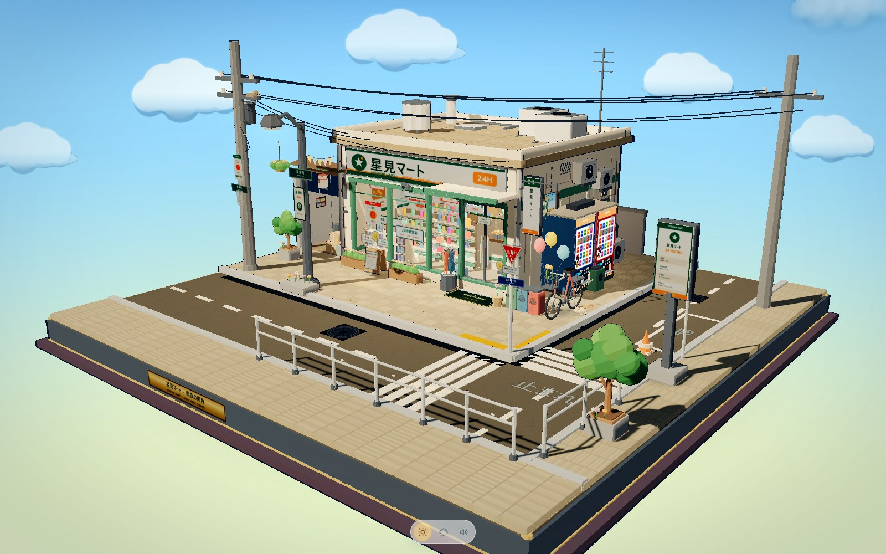
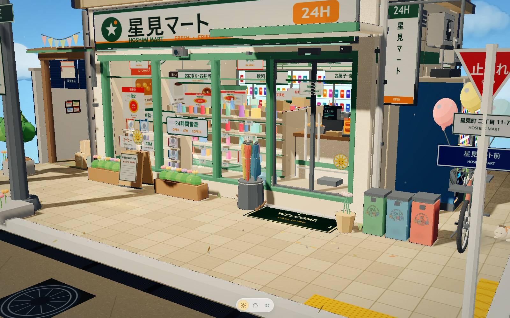
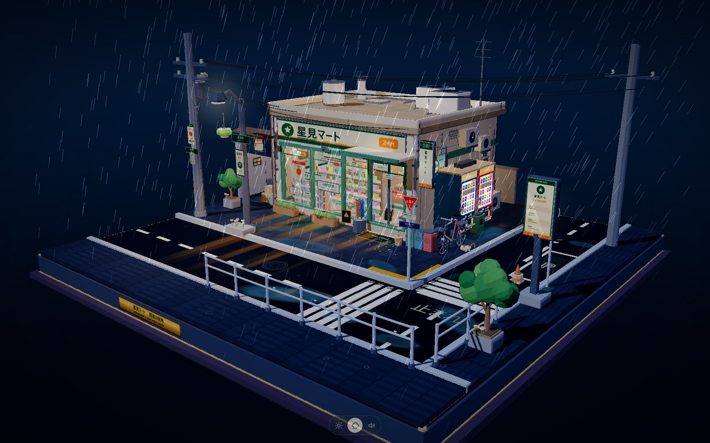
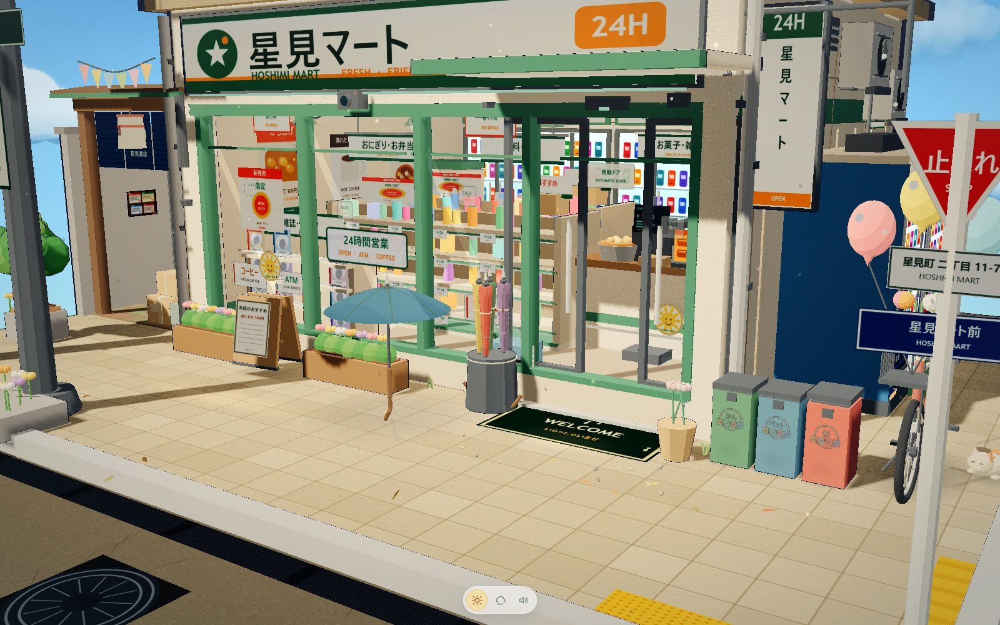

# 星見マート · 雨と晴れの街角

一个可拖拽、旋转、缩放观看的日式便利店街角微缩模型。使用 three.js 程序化生成，三渲二风格，所有模型元素都搭建在完整的正方形底座上。**晴天与雨夜共用同一个网页、同一套模型与机位**，通过底部中央的极简天气图标切换；场景中的自动贩卖机、自行车、雨伞架、自动门、绿植、气球和海报也都可以轻触互动。

**在线预览：** <https://xyy99888-byte.github.io/hoshimi-mart-diorama/>









## 打开方式

直接双击打开根目录的 **`index.html`**。它是完全离线的单文件版本，three.js、OrbitControls、后处理着色器、全部场景代码和音效数据均已内联，不依赖网络；`audio/` 目录同时保留可替换的音频片段，方便检查来源。

也可以本地起静态服务预览开发版：

```bash
python -m http.server 8765
# 打开 http://127.0.0.1:8765/index.dev.html
```

## 天气切换

- 页面默认展示**晴天**。底部中央只有太阳 / 雨云 / 小喇叭图标，没有其他 HUD 或文字面板。
- 点击太阳：晴天。点击雨云：雨夜。点击小喇叭：全局静音，再次点击恢复。
- 键盘 **W** 也可以在两种天气之间切换。
- 切换约用 1.4 秒做光照、天空、雾、地面材质、雨效、霓虹和装饰的平滑过渡。
- 也可以通过 URL 指定初始天气：`?weather=sunny` 或 `?weather=rain`。选择会记录在浏览器中，下一次打开沿用。
- 场景始终以完整组装状态展示，方便立即观看两种天气，不再播放组装入场动画。

## 轻交互

所有交互都使用 `Raycaster` 从相机发出触控射线，没有弹窗、没有悬浮面板、没有文字提示；反馈只由缓慢动画、光影和写实轻音效组成。鼠标悬停在可互动物件上会变成小手，空白区域保持默认箭头。

### 通用交互

- **自动贩卖机**：点击机身后商品灯柔和亮起；机组下方的实体按键可按下回弹并发出机械声；底部托盘的 4 瓶饮料可点选，饮料轻轻上浮进入拾取状态，可拖到地面、窗台或自行车车篮；放进车篮后会跟随自行车，点击可放回原位。
- **自行车**：点击车铃会抖动并发出真实老式金属车铃；按住车身可在安全范围短距离拖动，车轮同步转动，松手后平滑停下；雨夜拖动时后轮会留下浅浅水渍拖痕。
- **雨伞架**：架内 **5 把完全同款的长柄日式雨伞**，参照 60 cm / 8 本骨长伞与 1:12 微缩伞的比例统一制作：收拢是带米色伞带与金属扣的细长伞身，撑开后伞面直径统一为 **1.0 个场景单位**。每把都有独立的一套 **8 根伞骨骨骼 + 中心根骨骼 + 蒙皮伞面**；取出一把后，伞骨带动伞面同步舒展/折叠，不会漂浮、塌陷或错位。外观恢复**最初雨夜版的五色伞面**：深蓝、砖红、芥末黄、墨绿、灰紫；五把共用同一套结构，仅布面颜色不同，配深色细伞骨、圆润手柄和米色伞带。架体增加了金属固定环、五个橡胶内衬夹口与径向支撑臂，五把伞垂直、等距插入，不倾斜、不互相穿插。点击伞架取出，晴天再点伞身撑开、再点收拢，雨夜取出自动撑开；拖回伞架或点击伞架会自动收拢并吸附回自己的槽位。开合速度、幅度和伞面尺寸五把完全一致。
- **自动门**：**只支持点击门体**：点击打开，再点一次关闭；镜头靠近或扫过不会触发。开关伴随柔和低沉的滑轨声，晴天开门时门口有暖光。
- **树木/绿植**：点击树冠，叶片轻摆；晴天出现透过树叶的 Tyndall 光束，雨天则从叶片滴落雨滴。
- **彩色气球**：气球连同细绳固定在自行车车篮上，自行车拖拽时整串同步移动；轻点气球或气球串会轻轻晃动并恢复；长按单个气球可拖拽，松手后随风缓慢浮动并回弹，气球之间会轻轻弹开，不会飘出底座。
- **公告栏海报**：点击会稍微放大，再次点击复原；连续点击会在“夏祭り / 新商品 / 寻找小猫”等不同海报图案之间循环。
- **垃圾桶**：点击红色纸类垃圾桶，盖子打开，里面能看到纸屑，再次点击闭合，并伴塑料盖弹动闷响。
- **路灯**：点击开关。晴天点亮只有微弱暖光；雨夜点亮会增强路面光晕和湿地反光，关灯后反光消失。
- **空调外机**：点击启动风扇并播放低频运转声，再次点击停止。
- **电线杆小鸟**：点击后小鸟扑扇翅膀并发出轻声鸟鸣，几秒后停下。
- **路牌**：点击后像被风吹动一样轻晃。
- **监控摄像头**：点击后会缓慢转向另一侧，伴随很轻的机械转动声。
- **纸箱堆**：点击角落纸箱，纸箱组会轻轻晃动后回正。
- **掉落落叶**：点击地面落叶，叶片会轻轻飘起，再缓慢落回地面。

### 晴天专属

- **门口花盆**：点击花朵会让花瓣微微舒展；长按约 0.5 秒会从花丛飞出一只迷你小蝴蝶，在附近缓慢盘旋后回到花上；雨天蝴蝶隐藏。
- **地面光斑**：点击光斑会短暂闪烁，并随云影缓慢偏移。
- **门口立牌**：点击小型 A 字广告架，可在三张手绘菜单/促销海报之间切换。
- **晴天街角**：花坛边缘的小雏菊、三叶草与杂草；地面上有随风缓慢滚动的干枯落叶。

### 雨夜专属

- **积水**：点击产生双层扩散涟漪，可连续点击叠加，逐渐消散。
- **屋檐排水口**：点击后雨量短暂增大，水流从排水口落下并在地面积水持续激起涟漪，几秒后恢复。

### 彩蛋

连续快速点击便利店招牌三次，招牌外圈会缓慢呼吸闪烁约 2.5 轮：晴天是淡淡暖微光，雨夜是柔和青白外发光；同时播放一声偏轻、偏低沉的便利店提示音，结束后平滑回到原本的日间/夜间亮度，不会持续频闪。

### 雨伞造型参考

制作前参考了 60 cm / 8 本骨长柄伞的常见结构与 1:12 微缩伞比例，并统一为同一套尺寸：

- [Ogawa 60 cm / 8 本骨长柄伞商品页](https://www.amazon.co.jp/dp/B0CW2K5RJM/)：确认 60 cm 亲骨、8 根伞骨与长柄规格。
- [小宮商店 伞骨结构资料](https://www.komiyakasa.jp/en/pages/encyclopedia-umbrella-bone)：确认伞骨、伞面与中棒的结构关系。
- [1:12 微缩 J 形手柄收拢伞](https://mforminiatures.com/products/dollhouse-supplies-miniature-umbrella-miniature-umbrella-miniature-umbrella-dollhouse-supplies-umbrella-f062)：参考微缩伞收拢后的细长形态与手柄比例。
- [1:12 微缩伞面参考](https://mforminiatures.com/products/1-12-miniature-sun-umbrella-fabric-umbrella-lace-umbrella-1-inch-scale-miniature-umbrella-g053)：参考微缩伞面、伞骨密度与整体比例。

最终 5 把雨伞共用 `1.0` 场景单位的伞面直径（半径 `0.5`）、8 根伞骨、同一开合节奏与同一套结构；颜色回到最初雨夜版的深蓝、砖红、芥末黄、墨绿、灰紫。晴天使用带细伞骨投影的柔和贴地阴影，雨夜加入很轻的 Fresnel 湿润边缘反光。

### 街角细节与参考

本轮参考了日式便利店实拍、街角微缩 diorama 和日本街道公共设施结构：

- [7-Eleven 日本门店夜间外立面参考](https://www.collectivememory.ai/memory/9cea5faa-6dc2-48b7-9/)：玻璃自动门、店内暖光、玻璃海报、门前铺装与栏杆分层。
- [7-Eleven 日本置看板设计变化](https://www.itmedia.co.jp/business/articles/2308/05/news029.html)：店面招牌、立式广告与门前小品的比例关系。
- [FamilyMart 绿白蓝招牌设计](https://kanbankeiei.com/2018/11/06/181107/)：连锁便利店门头配色与识别元素。
- [電柱図鑑](https://denchu-zukan.com/zukan)：电线杆横担、绝缘子、变压器、爬钉、号牌与附属物结构。
- [TOMICA 7-Eleven 与自动贩卖机微缩场景](https://www.toy-people.com/en/?p=115994)：微缩便利店、贩卖机与停车场的层次和密度。
- [Beika-cho 便利店微缩场景套件](https://www.michaels.com/product/beikacho-convenience-store-dollhouse-kit-miniature-wizardi-roombox-kit-f07m586cwgc222-608097162837147655)：微缩店面内部与门前小物的陈设比例。

新增细节包括：

- **建筑**：墙面接缝、墙角污渍、檐口排水槽与落水管、外墙管线与卡箍、招牌背部支撑、窗框横梃、玻璃小贴纸、空调格栅螺丝与冷凝管。
- **自动贩卖机**：价格标签、贴纸、划痕、硬币面板、出货口边框与四角螺丝。
- **自行车**：链条、曲柄脚踏、刹车线、车架焊点、座椅纹理与轮胎胎纹。
- **街道**：电线杆扎带与固定夹、旧传单、垃圾桶污渍与标签、路牌地址小牌与固定螺丝、护栏掉漆、排水沟落叶。
- **门前**：地垫污渍、小石子、烟头、落叶、入户感应灯、监控摄像头、纸箱与塑料收纳筐。
- **晴天**：小雏菊、三叶草、杂草、随风滚动的干叶与可点击 A 字广告架。
- **雨夜**：墙面/立柱/垃圾桶底部水痕、排水沟流动水纹、橱窗雾气与更柔和的水光。

### 生活化动态

- 自行车旁新增一只睡觉的三花猫，身体随呼吸轻微起伏，尾巴缓慢摆动。
- 晴天增加少量樱花瓣在空中缓慢飘落，落到地面后循环重生。
- 雨夜增加招牌、贩卖机、路灯下方极淡的霓虹湿地反光。
- 云朵缓慢漂移，祭典三角旗随风轻摆。
- 第一次点击场景后，以极低音量加入环境底噪：低频城市/空调环境声，晴天偶尔远处鸟鸣，雨天偶尔轻微落水声。

### 音频

- 音效全部替换为真实的 **Freesound CC0** 录音：落罐、机械按键、老式车铃、雨伞布料/伞骨、玻璃门滑轨、塑料垃圾桶盖、落水、空调低频、麻雀、店门提示音和开关声。
- 环境底噪复用同一批 CC0 录音，只在第一次交互后低音量启动，并受全局静音控制。
- 默认音量偏低；底部小喇叭可全局静音，设置会记录在浏览器中。
- 音效数据以 base64 内嵌，单文件离线时也能播放；只有第一次触发对应交互时才解码和创建音频节点。
- 完整来源、作者和 CC0 许可：[AUDIO_CREDITS.md](AUDIO_CREDITS.md)。

## 操作

- 鼠标左键拖拽：旋转观察
- 鼠标滚轮 / 双指开合：缩放
- 点击/轻触场景物件：触发对应的轻交互
- 长按气球：轻轻拖拽，松手后飘回
- 底部小喇叭：全局静音 / 恢复音效
- 鼠标悬停在可互动物件上为小手，空白处为默认箭头
- 右键拖动与平移已关闭，保证模型构图不被移出画面
- 默认不自动旋转，完全交给用户控制

## 晴天场景

- 清澈蓝天、柔软白云，暖色斜射日光与柔和阴影
- 完全干爽的路面与斑马线，无雨丝、无积水、无湿地倒影
- 招牌与自动贩卖机不使用强发光；玻璃橱窗带轻微自然反光
- 街角新增树木、花箱、吊篮、灯柱花坛与自行车篮小花
- 自行车旁有彩色气球，巷口有祭典小旗，橱窗与墙面有手绘海报和可爱贴纸
- 门口、斑马线与墙脚有阳光光斑，空气中有轻微浮尘
- 店内布局、货架、商品、收银台、热食柜、ATM 等与雨夜版完全一致

## 雨夜场景

- 斜向雨丝、地面水花、湿润反光、霓虹与暖光溢出、轻雾、暗角
- 同一机位、同一模型、同一间店铺；雨夜原有的灯光与街景细节保持

## 内容

- 完整 14.32 × 14.32 方形展示底座，木/石/黄铜分层，正面有黄铜铭牌
- 日式便利店主体：招牌、24H 灯箱、玻璃橱窗、自动门、入口雨棚、地垫
- 店内：货架与商品、冷藏饮料柜、收银台、收银机、热食柜、咖啡机、关东煮、杂志架、ATM、吊牌导视、暖光
- 街景：两台自动贩卖机、自行车、雨伞架、分类垃圾桶、街灯、电线杆与电线、路牌、止まれ、街角护栏、停车位、排水沟、反光斑马线、小巷入口、纸灯笼、空调外机、公告栏等
- 可交互物件：两台自动贩卖机与按键/饮料、自行车与车铃、入口雨伞架、自动门、两棵树与晴天光束/雨滴、三只气球、左右公告栏海报、红色垃圾桶、路灯、空调外机、电线杆小鸟、路牌、门口花盆与蝴蝶、晴天光斑、积水与屋檐排水口、监控摄像头、纸箱堆、掉落落叶、晴天 A 字立牌
- 无人物；除天气/静音图标外没有其他 UI 元素

## 源码结构

- `src/main.js`：场景、程序化贴图、模型、材质、灯光、雨效、晴天装饰、天气混合与 Raycaster 轻交互系统
- `src/style.css`：全屏画布、天气/静音切换器与昼夜暗角
- `src/audio-data.js`：从 CC0 音频片段生成的 base64 离线音频库
- `audio/`：实际打包的 12 段短音效与 `clips.json` 参数
- `AUDIO_CREDITS.md`：全部音效的作者、来源与 CC0 许可
- `index.dev.html`：开发版入口（引用 vendor/src）
- `index.html`：构建后的单文件交付版本
- `vendor/`：three.js r128、OrbitControls、EffectComposer、UnrealBloomPass 等
- `build.py`：把 vendor、音频库与 src 内联进 `index.html`

重新构建：

```bash
python build.py
```

## 兼容性

- 使用 WebGL 的现代桌面浏览器
- 支持触摸拖拽、双指缩放、触控点击与移动端自适应
- 单文件离线打开不需要本地服务器
